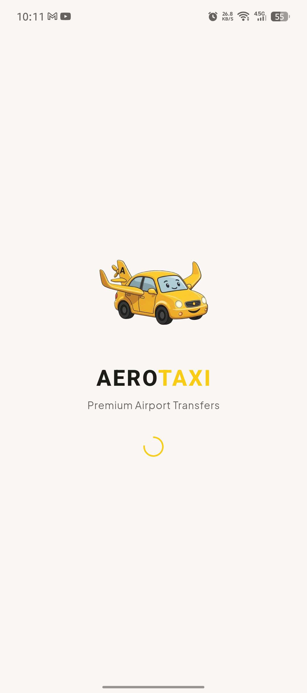
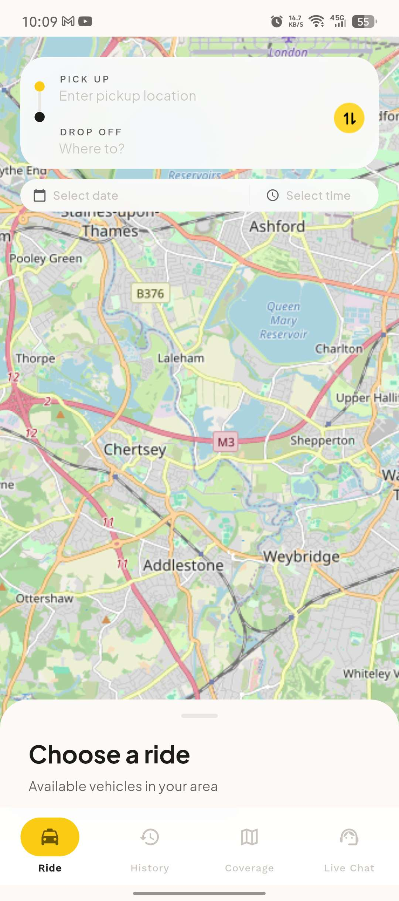
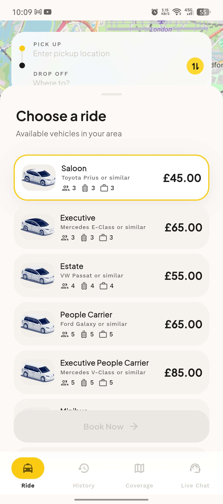
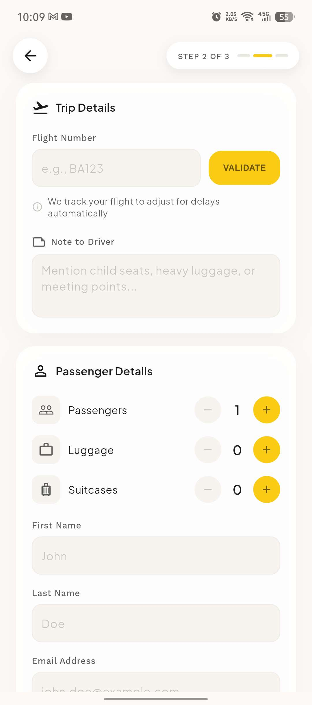
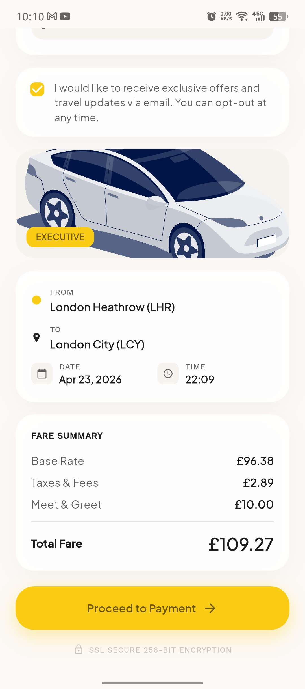
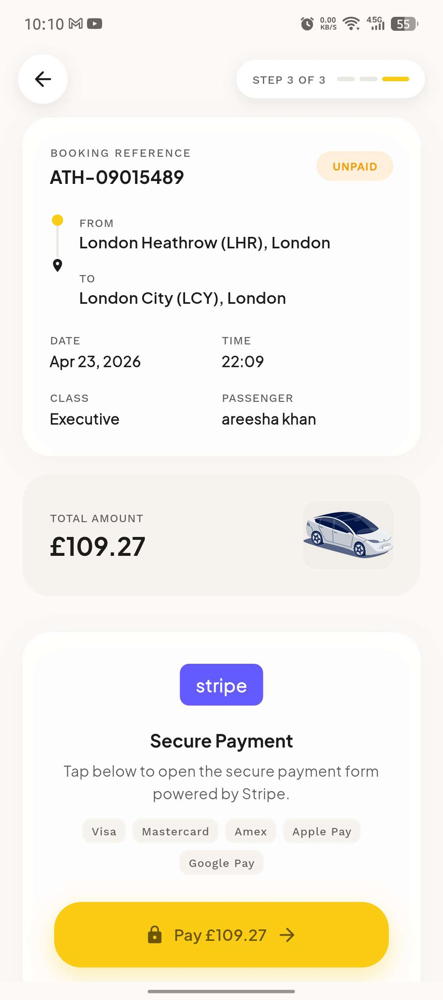
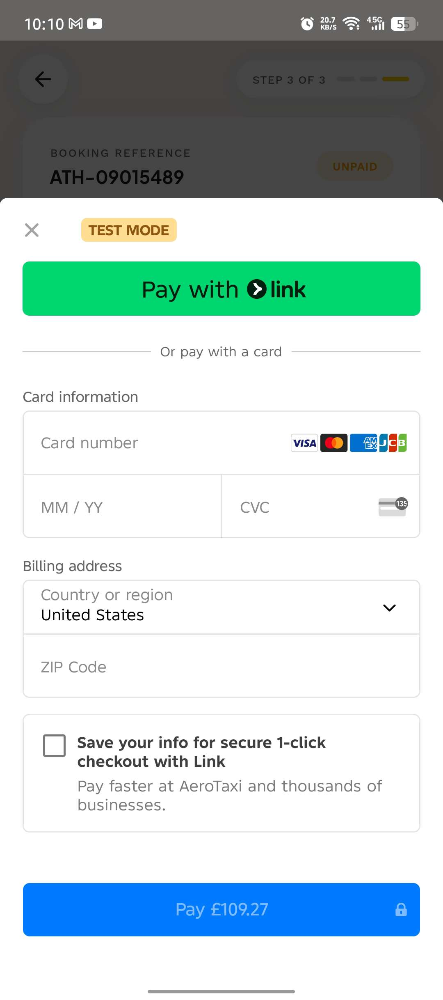
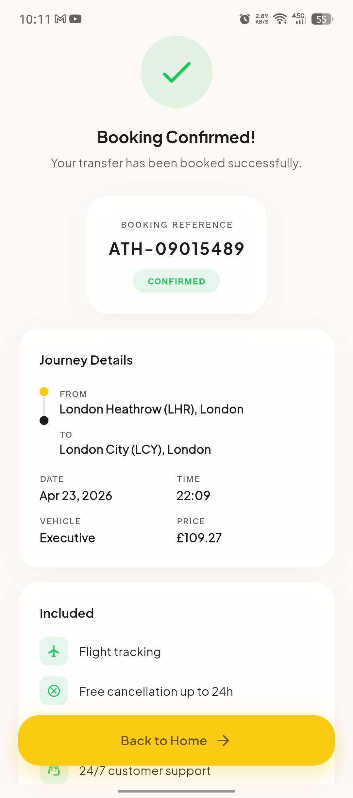

# AeroTaxi - Airport Transfer Booking App

<p align="center">
  
</p>

<p align="center">
  <strong>Premium Airport Transfer Booking App</strong><br>
  Built with Flutter | Stripe Payments | Firebase | Real-time Maps
</p>

<p align="center">
  
  
  
  
  
</p>

---

## Screenshots

| Loading | Home Screen | Choose a Ride |
|:-------:|:-----------:|:-------------:|
|  |  |  |

| Details Page | Details (Extras) | Payment |
|:------------:|:----------------:|:-------:|
|  |  |  |

| Stripe Payment | Confirmation |
|:--------------:|:------------:|
|  |  |

---

## Features

### Booking Flow
- **Live Interactive Map** - Full-screen OpenStreetMap with real-time panning and zooming
- **Location Search** - Nominatim geocoding with UK airport suggestions shown on focus
- **Route Visualization** - OSRM-powered polyline with pickup and dropoff markers
- **Distance & Duration** - Real-time calculation from OSRM routing API
- **Dynamic Pricing** - Formula-based pricing using short/long base + per-mile rate
- **7 Vehicle Classes** - Saloon, Executive, Estate, People Carrier, Executive People Carrier, Minibus, 16 Pax
- **Date & Time Selection** - Auto-flow: pickup, dropoff, date, time, ride selection
- **Swap Locations** - One-tap reverse pickup and dropoff
- **Same Location Prevention** - Validates pickup and dropoff are different

### Passenger Details
- **Flight Validation** - Real-time flight lookup via FlightRadar24 API with airline detection
- **Passenger Counters** - Passengers, luggage, suitcases (capped by vehicle capacity)
- **Optional Extras** - Meet & Greet (10 GBP), Child Seats (free), Pet, Oversized Items
- **Note to Driver** - Custom instructions for the driver
- **Fare Summary** - Base rate + 3% taxes + extras with live total calculation

### Payments
- **Stripe Integration** - Native Payment Sheet on mobile (Android/iOS)
- **Web Support** - JS-based Stripe Payment Element for Chrome preview
- **PCI Compliant** - No card data touches the app
- **Test Mode** - Use card `4242 4242 4242 4242` with any future expiry and CVC

### Booking Management
- **Booking Confirmation** - Animated success screen with reference number
- **Persistent History** - All bookings saved locally via SharedPreferences + Firebase cloud database
- **Upcoming Rides** - Active bookings with CONFIRMED status badges
- **Ride Details** - Full breakdown with map, route, distance, duration, extras, flight info
- **Rebook** - One-tap rebook from history with pre-filled locations
- **Booking Lookup** - Search by reference number directly from Firebase database

### Communication
- **Email Confirmation** - Branded HTML email via Gmail SMTP after payment (mobile only)
- **Live Chat** - Crisp Chat integration via in-app browser
- **Contact Support** - Email, Phone, WhatsApp options from history page

### Design System - The Editorial Transit
- **Surface Hierarchy** - 6-tier tonal system replacing hard borders
- **No-Line Rule** - Boundaries defined through background shifts, not 1px borders
- **Glassmorphism** - Backdrop blur on floating elements
- **Plus Jakarta Sans** - Voice font for headings and titles
- **Work Sans** - Data font for labels and technical info
- **Ghost Borders** - 15% opacity outline-variant for subtle containment
- **Ambient Shadows** - 8% opacity, 32px blur (felt, not seen)
- **Cupertino Transitions** - iOS-style smooth page transitions on all platforms
- **Bouncing Scroll** - Elastic overscroll physics globally

---

## Tech Stack

| Layer | Technology |
|-------|-----------|
| **Framework** | Flutter 3.29 (Dart 3.7) |
| **State Management** | Provider (ChangeNotifier) |
| **Routing** | GoRouter with custom transitions |
| **Maps** | flutter_map + OpenStreetMap tiles |
| **Geocoding** | Nominatim API (OpenStreetMap) |
| **Routing Engine** | OSRM (Open Source Routing Machine) |
| **Payments** | Stripe (flutter_stripe native + JS interop for web) |
| **Cloud Database** | Firebase (Firestore) |
| **Local Storage** | SharedPreferences |
| **Email** | Gmail SMTP via `mailer` package |
| **Flight Validation** | FlightRadar24 Search API |
| **Live Chat** | Crisp Chat (in-app browser) |
| **Fonts** | Google Fonts (Plus Jakarta Sans, Work Sans) |
| **SVG Rendering** | flutter_svg |
| **URL Handling** | url_launcher |

---

## Project Structure

```
lib/
├── config/
│   ├── constants.dart              # API keys, URLs, app constants
│   ├── routes.dart                 # GoRouter route definitions
│   └── theme.dart                  # Editorial Transit design system
│
├── models/
│   ├── airport.dart                # Airport model (code, name, city, image)
│   ├── booking.dart                # Booking model (30+ fields incl. lat/lng, extras)
│   ├── vehicle.dart                # Vehicle model with pricing formula fields
│   ├── faq.dart                    # FAQ model
│   └── ...
│
├── providers/
│   ├── app_provider.dart           # Airports, vehicles, FAQs data
│   └── booking_provider.dart       # Booking state, persistence, Firebase sync
│
├── screens/
│   ├── splash_screen.dart          # Animated splash with logo + spinner
│   │
│   ├── home/
│   │   └── home_screen.dart        # Map + location inputs + vehicle drawer
│   │
│   ├── booking/
│   │   ├── transfer_details_screen.dart   # Flight, passenger, extras, fare
│   │   ├── payment_screen.dart            # Stripe payment integration
│   │   └── confirmation_screen.dart       # Success + booking reference
│   │
│   ├── history/
│   │   └── history_screen.dart     # Upcoming + past bookings + ride details
│   │
│   ├── coverage/
│   │   └── coverage_screen.dart    # Airport grid + booking lookup
│   │
│   └── chat/
│       └── chat_screen.dart        # Crisp live chat launcher
│
├── services/
│   ├── api_service.dart            # Static data provider (airports, vehicles)
│   ├── stripe_service.dart         # Stripe PaymentIntent creation
│   ├── stripe_pay.dart             # Native Payment Sheet (mobile)
│   ├── stripe_pay_stub.dart        # Web stub (no-op)
│   ├── stripe_init.dart            # Stripe SDK initialization (mobile)
│   ├── stripe_init_stub.dart       # Web stub (no-op)
│   ├── stripe_js_interop.dart      # Stripe JS interop (web)
│   ├── stripe_js_stub.dart         # Mobile stub (no-op)
│   ├── firebase_service.dart       # Firebase cloud database operations
│   ├── email_service.dart          # Email confirmation orchestrator
│   ├── email_sender.dart           # SMTP email sender (mobile)
│   └── email_sender_stub.dart      # Web stub (no-op)
│
└── widgets/                        # (Minimal - most widgets are screen-local)
```

---

## Pricing Formula

Each vehicle has two pricing tiers based on distance:

| Distance | Formula |
|----------|---------|
| **Short (up to 50 miles)** | `short_base + (short_per_mile x distance)` |
| **Long (over 50 miles)** | `long_base + (long_per_mile x distance)` |

### Vehicle Pricing Table

| Vehicle | Short Base | Short/Mile | Long Base | Long/Mile | Passengers | Luggage | Suitcases |
|---------|-----------|-----------|----------|----------|:---------:|:------:|:--------:|
| Saloon | 32.64 | 2.57 | 54.14 | 1.17 | 3 | 3 | 3 |
| Executive | 43.07 | 3.41 | 69.89 | 1.64 | 3 | 3 | 3 |
| Estate | 36.96 | 2.94 | 61.76 | 1.35 | 4 | 4 | 4 |
| People Carrier | 44.81 | 3.32 | 68.30 | 1.69 | 5 | 5 | 5 |
| Exec. People Carrier | 60.59 | 4.57 | 99.89 | 2.20 | 5 | 5 | 5 |
| Minibus | 71.85 | 3.90 | 96.78 | 1.52 | 8 | 8 | 8 |
| 16 Pax | 140.17 | 8.62 | 223.71 | 2.47 | 16 | 16 | 16 |

**Additional charges:**
- Taxes & Fees: 3% of base rate
- Meet & Greet: 10.00 GBP (optional)

---

## Supported Airports

| Code | Airport | City |
|:----:|---------|------|
| LHR | London Heathrow Airport | London |
| LGW | London Gatwick Airport | London |
| STN | London Stansted Airport | London |
| LTN | London Luton Airport | London |
| LCY | London City Airport | London |
| SEN | London Southend Airport | Southend |
| MAN | Manchester Airport | Manchester |
| EDI | Edinburgh Airport | Edinburgh |
| BHX | Birmingham Airport | Birmingham |
| BRS | Bristol Airport | Bristol |
| NCL | Newcastle Airport | Newcastle |
| BFS | Belfast International Airport | Belfast |

---

## Setup & Installation

### Prerequisites
- Flutter 3.19 or higher
- Android Studio or Xcode
- A Stripe account (test mode works)
- A Firebase account (free Spark plan)
- A Crisp account (free tier)

### Quick Start

```bash
# Clone the repository
git clone https://github.com/AreeshaKhan25/AeroTAXI

# Install dependencies
flutter pub get

# Run on connected device (debug)
flutter run

# Build release APK (optimized)
flutter build apk --release

# Install release APK on device
flutter install
```

### Configuration

Update the following files with your own credentials:

| File | What to Update |
|------|---------------|
| `lib/services/stripe_service.dart` | Stripe secret key |
| `lib/services/stripe_init.dart` | Stripe publishable key |
| `web/index.html` | Stripe publishable key (web) |
| `lib/services/firebase_service.dart` | Firebase project config |
| `google-services.json` | Firebase Android config |
| `GoogleService-Info.plist` | Firebase iOS config |
| `lib/screens/chat/chat_screen.dart` | Crisp website ID |
| `lib/services/email_sender.dart` | Gmail address + app password |

---

## API Integrations

| API | Purpose | Auth | Free Tier |
|-----|---------|:----:|:---------:|
| **OpenStreetMap** | Map tiles rendering | None | Unlimited |
| **Nominatim** | Geocoding and location search | None | 1 req/sec |
| **OSRM** | Route calculation and distance | None | Unlimited |
| **FlightRadar24** | Flight number validation | None | Unlimited |
| **Stripe** | Payment processing | API keys | Test mode free |
| **Firebase** | Cloud database | Firebase config | 1GB storage free |
| **Gmail SMTP** | Email confirmation | App password | 500/day |
| **Crisp** | Live chat support | Website ID | 2 agents free |

---

## Architecture Decisions

- **Platform-conditional imports** - Stripe SDK on mobile, JS interop on web (no `dart:io` on web)
- **Fire-and-forget Firebase sync** - Bookings save locally first, sync to cloud non-blocking
- **Email after payment only** - Confirmation email fires only after Stripe payment succeeds
- **No backend dependency** - App works fully offline; API calls are optional with local fallbacks
- **Editorial design over utilitarian** - Tonal surfaces instead of borders, ambient shadows instead of drop shadows

---

## Build Info

| Metric | Value |
|--------|-------|
| **Release APK Size** | ~32 MB |
| **Min Android SDK** | 21 (Android 5.0) |
| **Target Android SDK** | 35 |
| **Kotlin Version** | 2.1.0 |
| **iOS Min Version** | 12.0 |

---

## License

This project is proprietary. All rights reserved.

---

<p align="center">
  Built with Flutter & Love<br>
  <sub>AeroTaxi - Premium Airport Transfers</sub>
</p>